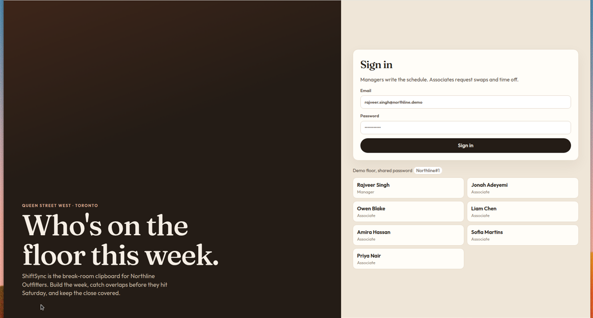
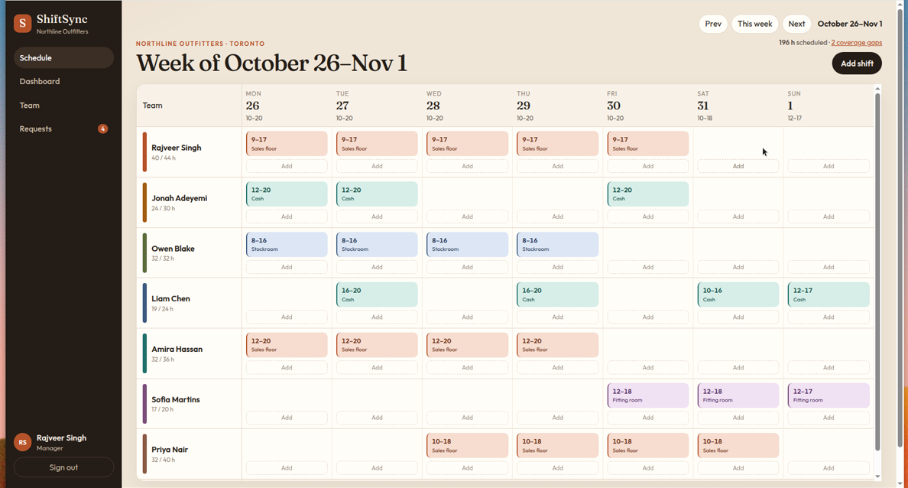
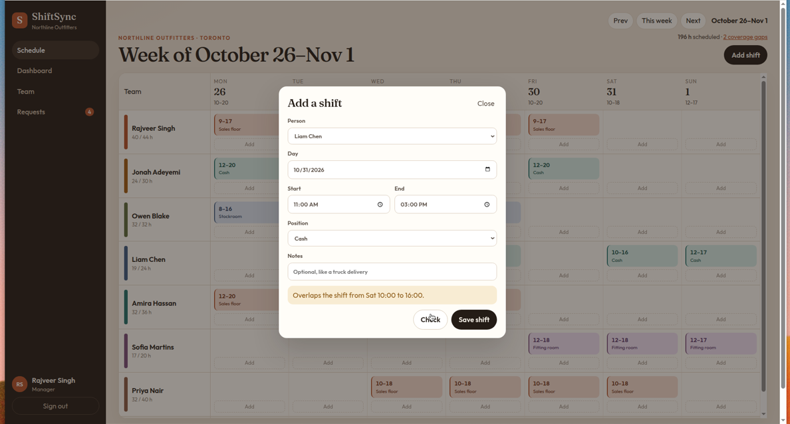
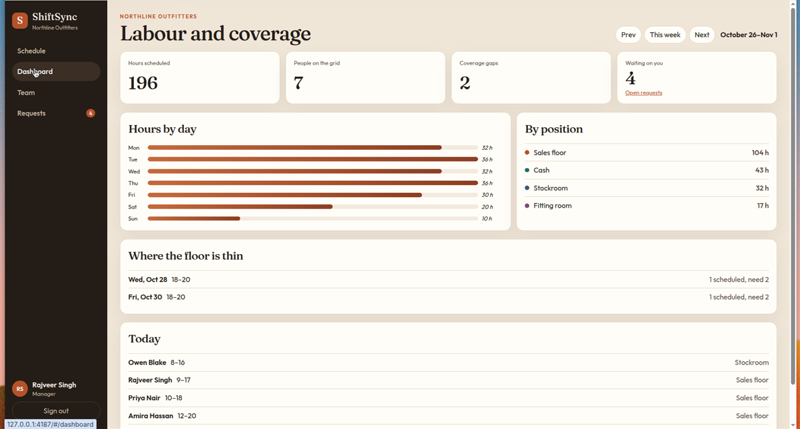
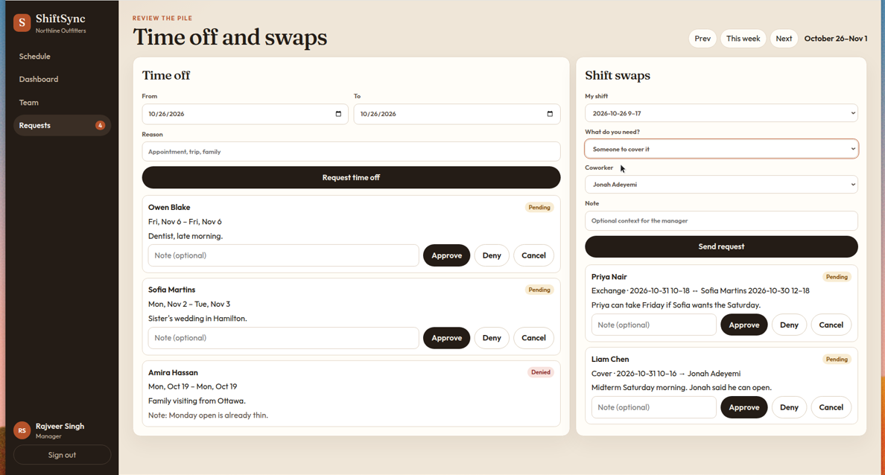
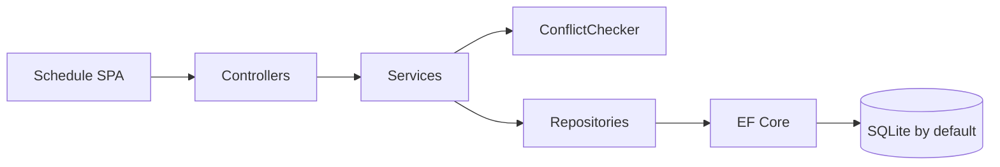

# ShiftSync

ShiftSync is a weekly staff scheduler for a retail store. Managers build the floor on a grid. Associates ask for a swap or a day off. The same rules that draw the week also refuse a shift that overlaps, falls outside someone's availability, or blows past their hour cap.

The demo store is **Northline Outfitters** on Queen Street West in Toronto. Rajveer Singh runs the floor.



## Features

- Weekly schedule for a store, with shifts coloured by position (sales floor, cash, stockroom, fitting room)
- Employee profiles, a weekly hour cap, and availability windows
- Managers add, edit, and delete shifts from the grid
- Conflict checks before a shift is saved: overlaps, outside availability, over the weekly cap, and approved time off
- Associates request a cover, an exchange, or time off. Managers approve or deny. An approval rechecks the rules against the schedule after the move
- Dashboard for the week: labour hours by day and position, and the open hours that are short of the minimum
- JWT auth with Manager and Associate roles
- Seeded demo week, including two real coverage gaps (Wednesday and Friday close)
- Swagger at `/swagger`









## Architecture

```text
src/ShiftSync.Api              controllers, JWT, ProblemDetails, static SPA
src/ShiftSync.Application      services, DTOs, ConflictChecker, CoveragePlanner
src/ShiftSync.Infrastructure   EF Core, repositories, migrations, demo seed
src/ShiftSync.Domain           entities and the scheduling rules' types
tests/ShiftSync.Tests          xUnit
```



Controllers stay thin. Services own the use cases. Repositories are the only thing that talks to EF Core. `ConflictChecker` is a pure function: give it the draft shift, the person's other shifts, their availability, and approved time off, and it returns the problems. The dashboard's gap list uses the same idea in `CoveragePlanner`.

Errors are [ProblemDetails](https://datatracker.ietf.org/doc/html/rfc7807). A scheduling conflict is HTTP 409 and includes a `conflicts` array, which is what the modal prints. Model validation failures are HTTP 400 with the usual `errors` object.

The UI is a small static SPA in `wwwroot`. There is no Node build. `dotnet run` serves the API and the pages together.

## Run it

```bash
git clone https://github.com/Rajveerrsingh/ShiftSync
cd ShiftSync
```

You need the .NET 8 SDK.

```bash
dotnet run --project src/ShiftSync.Api
```

Then open http://localhost:4187.

The dev JWT signing key lives in `appsettings.Development.json`. If `Jwt:Key` is missing outside Production, the API falls back to that same dev value and logs nothing secret. **Production refuses to boot until `Jwt__Key` is set.** It has to be at least 32 characters. Do not ship the dev key.

```bash
export Jwt__Key="replace-this-with-a-long-random-string"
export ASPNETCORE_ENVIRONMENT=Production
dotnet run --project src/ShiftSync.Api
```

SQLite file `src/ShiftSync.Api/shiftsync.db` is created on first run and seeded once. Delete that file to seed again.

### Docker

```bash
docker build -t shiftsync .
docker run --rm -p 8080:8080 shiftsync
```

The image listens on port 8080 and stores the database in `/data`. The image sets a dev `Jwt__Key` so the demo starts. Override it for anything real:

```bash
docker run --rm -p 8080:8080 \
  -e Jwt__Key="replace-this-with-a-long-random-string" \
  -e ASPNETCORE_ENVIRONMENT=Production \
  -v shiftsync-data:/data \
  shiftsync
```

### SQL Server or Postgres

SQLite is the default. Set `Database:Provider` and the connection string (or the env vars `Database__Provider` and `ConnectionStrings__Default`). SQL Server and Postgres use `EnsureCreated` instead of the SQLite migrations.

```json
"Database": { "Provider": "SqlServer" },
"ConnectionStrings": {
  "Default": "Server=localhost;Database=ShiftSync;User Id=sa;Password=...;TrustServerCertificate=True"
}
```

```json
"Database": { "Provider": "Postgres" },
"ConnectionStrings": {
  "Default": "Host=localhost;Username=shiftsync;Password=...;Database=shiftsync"
}
```

## Demo logins

Every account uses the password `Northline#1`.

| Name | Email | Role |
| --- | --- | --- |
| Rajveer Singh | rajveer.singh@northline.demo | Manager |
| Amira Hassan | amira.hassan@northline.demo | Associate |
| Liam Chen | liam.chen@northline.demo | Associate |
| Priya Nair | priya.nair@northline.demo | Associate |
| Owen Blake | owen.blake@northline.demo | Associate |
| Sofia Martins | sofia.martins@northline.demo | Associate |
| Jonah Adeyemi | jonah.adeyemi@northline.demo | Associate |

On the sign-in page, outside Production, each name is a button. The interesting week is the current one: Wednesday and Friday evenings are one person short of the minimum of two. Liam has a pending cover for Saturday, and Priya has a pending exchange with Sofia.

## Tests

```bash
dotnet test
```

Unit tests cover the conflict rules (overlap, back-to-back shifts, availability windows, the weekly cap, time off) and how coverage gaps are merged. The API tests sign in through the real JWT pipeline and hit the schedule, swap, time-off, and dashboard endpoints, including a 409 when an approved cover would break someone's cap.

GitHub Actions (`.github/workflows/ci.yml`) restores, builds, and runs that suite on pushes and pull requests.

## Interview notes

A few things I'd actually walk through:

- The conflict rules are not buried in a controller. `ConflictChecker` doesn't know about EF or HTTP, so the overlap and hour-cap cases are plain xUnit facts. The endpoint tests then prove the API returns those same failures as ProblemDetails.
- Managers and associates share one API. The role is a `role` claim on the JWT. Creating a shift without that claim is a 403, not a hidden button.
- Approving a swap is not a status flip. The service builds the schedule as it would look after the move and runs the same checker. If Jonah is already at his cap, the cover stays pending and the shift stays on Liam.
- SQLite is there so `dotnet run` is the whole demo. The DbContext picks SQL Server or Postgres from configuration, which is the path I'd use if a team already had one of those.
- Availability is a set of windows, not a single "I work days." A shift has to fit inside one window, so a split day (morning and evening) is representable and tested.
- What I'd add next if this were in a store: recurring shifts, a published-versus-draft week, and an audit log of who moved a shift. I would not add those before the conflict rules were boringly correct.
